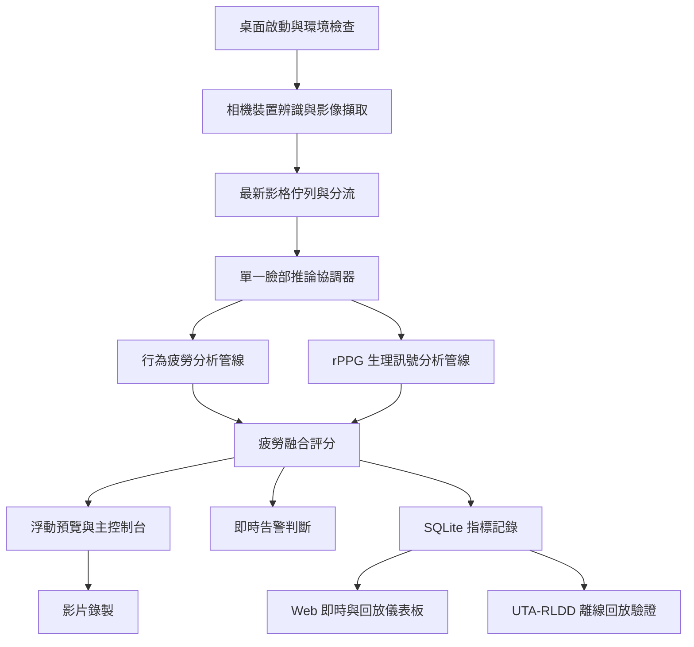
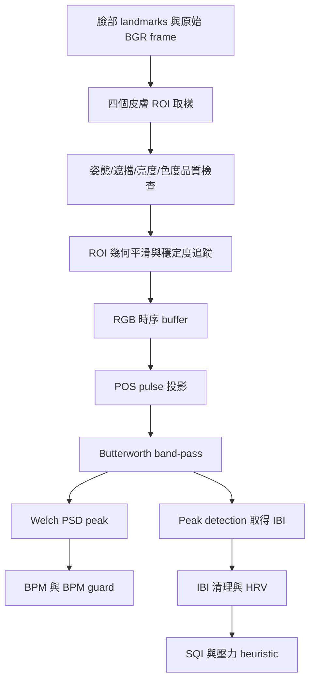
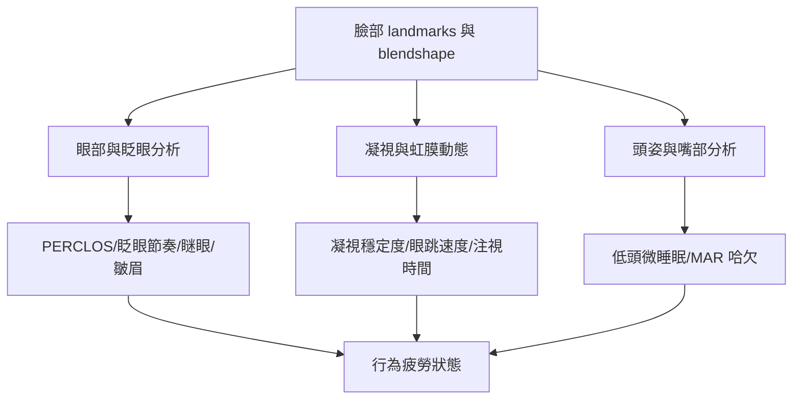
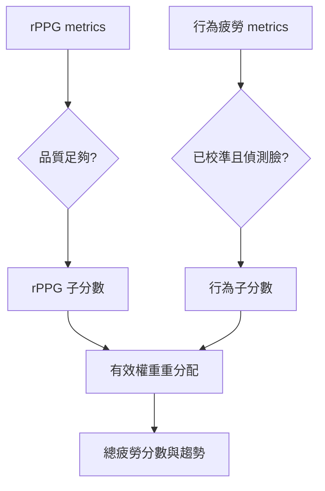

# 系統架構與演算法用途總覽

更新日期：2026-06-16

本文件以「用途名稱」描述專案結構與資料流，不以實際程式檔名作為架構節點。需要回到程式時，請依「所屬區域」對照專案資料夾責任。

## 閱讀原則

- 「所屬區域」只標示資料夾或資源類型，避免把架構圖寫成檔名清單。
- 本文件描述目前程式碼實作，不代表臨床醫療等級量測；rPPG 與疲勞分數仍需搭配資料集與真實裝置驗證。
- 既有部分中文文件與註解有編碼損壞，本文件改以可讀程式邏輯、測試與設定檔為準。

## 整體資料流



核心概念是「一個影格只做一次臉部推論」。當 rPPG 與疲勞分析同時啟用時，系統用單一 MediaPipe Face Landmarker 取得 landmark、blendshape 與 transformation matrix，再分別餵給兩條分析管線，最後合併分數並輸出到 GUI、錄製、Web 與驗證報表。

## 用途導向檔案架構

| 架構用途名稱 | 所屬區域 | 主要責任 | 常見使用情境 |
| --- | --- | --- | --- |
| 桌面啟動與 Qt 環境守門 | 專案根目錄 | 設定 PySide6 plugin 路徑、檢查 Ubuntu Qt xcb runtime、建立主視窗 | 啟動桌面程式、處理 Linux GUI runtime 缺件 |
| 主控制台與任務編排 | 桌面介面區 | 管理相機、分析 worker、overlay、錄製、Web server、UTA-RLDD 回放與熱鍵 | 使用者按下開始、停止、錄製、開啟 dashboard |
| 浮動監看 Overlay | 桌面介面區 | 顯示即時影像、FPS、rPPG、疲勞分數、融合分數與簡易波形 | 操作員看即時狀態與警示 |
| 相機裝置辨識策略 | 桌面介面區 | Windows 優先 DirectShow 名稱，Linux 優先 V4L2 與穩定裝置標籤，必要時 OpenCV probe | 相機下拉選單、跨平台攝影機相容 |
| 影像擷取背景工作 | 桌面介面區 | OpenCV 讀取影格、套用解析度/FPS、估算即時 FPS、輸出預覽與 BGR 影格 | 即時 camera feed、餵給分析與錄影 |
| 最新影格佇列工具 | 桌面介面區 | 佇列滿時丟棄舊影格，只保留最新畫面 | 降低分析延遲，避免 worker 追處理過期影格 |
| 單一臉部推論協調器 | 桌面介面區 | 建立 Face Landmarker，對每個影格執行一次臉部偵測，分送結果給疲勞與 rPPG 管線 | 同時開啟行為疲勞與生理訊號監測 |
| 行為疲勞計算核心 | 桌面介面區 | 計算 EAR、PERCLOS、眨眼節奏、凝視、虹膜、皺眉、頭姿、哈欠與微睡眠 | 判斷 OK、LOW_VIGILANCE、DROWSY、CRITICAL、MICROSLEEP |
| 行為標註與單獨分析模式 | 桌面介面區 | 繪製眼睛、虹膜、頭姿軸、嘴部、PERCLOS 熱條與警示標籤；支援只開疲勞分析 | 單獨測疲勞偵測或產生帶標註預覽 |
| rPPG 生理訊號核心 | 生理訊號區 | 抽取臉部 ROI 顏色、POS pulse、band-pass、Welch peak、IBI/HRV、SQI、BPM guard | 估計 BPM、RMSSD、SDNN、LF/HF、壓力 heuristic |
| rPPG 獨立示範工具 | 生理訊號區 | 不經完整 GUI，直接用 webcam 驗證 rPPG pipeline | 演算法開發、相機與 ROI 快速測試 |
| 融合疲勞評分器 | 桌面介面區 | 將行為疲勞與 rPPG 正規化分數合併；資料品質不足時動態調整權重 | 產生 0 到 1 的總疲勞分數與趨勢 |
| 指標資料記錄器 | 桌面介面區 | 寫入 SQLite、批次 flush、WAL 模式、schema migration | 儲存每次監測 session 的時間序列資料 |
| 影片錄製背景工作 | 桌面介面區 | 優先用 ffmpeg 寫 MP4，失敗時 fallback 到 OpenCV writer | 同步保存 overlay 或原始畫面 |
| Web 即時與回放服務 | 桌面介面區 | Flask + Socket.IO 即時推送、錄製清單、DB 回放、影片串流、File Browser 整合 | 瀏覽器 dashboard、遠端回放與檔案上傳 |
| Web 前端畫面資源 | Web 介面資源 | Dashboard HTML、CSS、JavaScript、圖表、即時狀態與回放控制 | 使用瀏覽器查看 live metrics 與歷史資料 |
| UTA-RLDD 離線驗證流程 | 桌面介面區與腳本區 | 掃描資料集影片、用生產引擎逐影格分析、輸出 DB/CSV/HTML/manifest | 批次驗證 Alert、Low Vigilant、Drowsy 標籤趨勢 |
| 告警設定與播放控制 | 桌面介面區與資產區 | 依疲勞狀態、延遲、重複間隔與優先級觸發音效；缺音檔時內建 beep fallback | LOW_VIGILANCE、DROWSY、CRITICAL、MICROSLEEP 警示 |
| MediaPipe 調校與校準儲存 | 設定區 | 管理偵測 confidence、ROI 權重、品質權重、blendshape baseline 與 profile | stable indoor、low light、high motion 場景調校 |
| 模型資產 | 模型資源區 | 保存 Face Landmarker 模型；缺模型時可自動下載 | 初次執行或模型被刪除後恢復 |
| 安裝、診斷與報告工具 | 腳本區 | Ubuntu 安裝、相機診斷、profile sweep、CSV/HTML/PDF 報告生成 | 部署、偵錯、驗證與產出技術報告 |
| 測試套件 | 測試區 | pytest 覆蓋 rPPG、MediaPipe tuning、錄製 schema、Web playback、UTA-RLDD 與告警 | 修改後驗證行為未回歸 |

## 即時執行流程

1. 使用者從主控制台選擇相機、解析度、FPS、是否水平翻轉與要啟用的分析項目。
2. 相機擷取工作啟動 OpenCV backend，持續讀取 BGR frame，並以 30 FPS 上限輸出 live preview 影格。
3. 分析佇列採「保留最新」策略，讓分析 worker 不追趕舊 frame。
4. 若 rPPG 與疲勞分析都啟用，系統使用單一臉部推論協調器；若只啟用其中一條，則啟用對應的單獨分析 worker。
5. MediaPipe Face Landmarker 以 VIDEO 模式處理 frame timestamp，輸出臉部 landmarks、blendshape scores 與 facial transformation matrix。
6. 行為疲勞管線與 rPPG 管線各自計算 metrics，融合評分器產生總分與分級。
7. GUI overlay、告警控制、SQLite 記錄、WebSocket 推播與影片錄製各自消費同一批 metrics 或影像來源。

## 主要演算法流程

### 臉部推論與共用輸入

- 使用 MediaPipe Face Landmarker，設定為單臉追蹤。
- 輸入是 OpenCV BGR frame 轉成 RGB 後的 MediaPipe image。
- 輸出包含 478 點 face landmarks、臉部 blendshape scores、facial transformation matrix。
- transformation matrix 優先用於 roll、yaw、pitch 推估；缺 matrix 時用 landmark 幾何距離 fallback。

### rPPG 生理訊號管線



ROI 取樣：

- 採用額頭、左臉頰、右臉頰、眉間四個 ROI。
- 每個 ROI 以 MediaPipe landmark polygon 產生 mask，套用 5x5 Gaussian blur 後取平均 RGB。
- 依 roll、yaw、pitch 估算 ROI 權重；依亮度過暗、過亮、色度過低或過高估算遮擋懲罰。
- 幾何穩定度包含 landmark jitter、ROI 面積變化與 EMA 平滑狀態。

POS pulse：

```text
R' = (R - mean(R)) / (std(R) + 1e-8)
G' = (G - mean(G)) / (std(G) + 1e-8)
B' = (B - mean(B)) / (std(B) + 1e-8)

X = 3R' - 2G'
Y = 1.5R' + G' - 1.5B'
alpha = std(X) / (std(Y) + 1e-8)
pulse = X - alpha * Y
```

頻域與心率：

- buffer 預設約 12 秒，至少暖機到足夠樣本後才輸出穩定 BPM。
- Butterworth band-pass 預設 0.65 到 3.7 Hz，對應約 39 到 222 BPM。
- Welch PSD 在 0.7 到 3.5 Hz 搜尋 peak，並用 log-power parabolic interpolation 細修 peak。
- BPM 合理範圍守門為 42 到 210 BPM；短時間大跳動需要持續確認才會被接受。
- BPM 穩定化使用近 10 秒候選值 median，再套 EMA 平滑。

HRV 與品質：

- pulse waveform 經 peak detection 取得 IBI，並移除 300 到 2000 ms 之外或局部 median 不一致的 interval。
- 輸出 RMSSD、SDNN、LF/HF、IBI artifact ratio、HRV confidence。
- SQI 以 0.6 到 4.0 Hz 頻帶能量占總 PSD 能量的比例計算。
- rPPG quality 綜合臉部姿態、臉部面積、運動、ROI 可用率、SQI、artifact ratio、landmark jitter 與 ROI area stability。

### 行為疲勞管線



眼部與 PERCLOS：

- EAR 使用左右眼各 6 點 landmark 估算眼睛開合。
- 啟動後先進行 EAR baseline 校準，再依個人 baseline 判斷閉眼。
- PERCLOS 以 60 秒滑動視窗計算閉眼時間比例。
- 長閉眼、PERCLOS 門檻與眨眼型態共同影響疲勞狀態。

微表情與認知疲勞：

- 瞇眼：持續低於半閉眼門檻但未達完整眨眼，超過時間門檻才觸發。
- 皺眉：內眉距離相對 baseline 下降時觸發。
- 眨眼節奏：以眨眼持續時間、振幅、睜眼速度建立 baseline，再用 z-score 形成 blink temporal score。
- 虹膜與瞳孔比例：用 iris radius / eye height 及 EMA trend 追蹤變化。

凝視與頭嘴：

- 凝視以虹膜中心相對眼框位置估算 gaze x/y。
- 眼跳速度由 gaze 位移除以時間差計算，並統計每分鐘眼跳次數。
- 長時間 fixation 或低眼跳頻率會觸發 gaze mental fatigue。
- 頭姿用 solvePnP 估算 pitch/yaw/roll，微睡眠聚焦在低頭 pitch 持續超過門檻。
- MAR 與嘴部開合比例搭配 blendshape baseline 判斷哈欠，但權重較低，作為晚期疲勞訊號。

狀態輸出：

- 未偵測臉：NO_FACE。
- 校準中：CALIBRATING。
- 正常：OK。
- 早期警示：LOW_VIGILANCE。
- 明顯疲勞：DROWSY。
- 長閉眼或危急：CRITICAL。
- 低頭微睡眠觸發：MICROSLEEP。

### 融合評分

融合評分輸出 0 到 1 的總疲勞分數。



- 兩條管線都可用時，預設 rPPG 權重 15%，行為疲勞權重 85%。
- rPPG 不可靠時，權重降為 0，由行為管線承擔；行為不可用而 rPPG 可用時則反向處理。
- rPPG 子分數包含 stress probability、BPM 偏離正常範圍與 LF/HF。
- 行為子分數包含 PERCLOS、眨眼節奏、微睡眠、凝視、瞇眼、哈欠；皺眉目前記錄但預設權重為 0。
- 趨勢以 30 秒滑動視窗比較分數變化。

## 錄製、Web 與回放

SQLite 記錄：

- 每筆資料含 camera metadata、rPPG metrics、疲勞 metrics、融合分數、品質診斷與 guard reason。
- 使用 WAL、NORMAL synchronous、批次寫入與 schema migration。
- 主要用途是歷史回放、報表分析與 UTA-RLDD 驗證。

影片錄製：

- 優先透過 ffmpeg 寫 MP4。
- 若 ffmpeg 或 libx264 不可用，fallback 到 mpeg4 或 OpenCV writer。
- 錄製來源會依目前啟用管線選擇：合併標註、單獨 rPPG、單獨疲勞或原始相機畫面。

Web 儀表板：

- 即時資料用 Socket.IO 推播。
- GUI 會在 Web server 啟動、管線開始/停止、相機資訊更新、FPS 更新、錄影切換與分析 metrics 到達時送出狀態封包。
- 新開或重新整理的 dashboard 會透過 `request_metrics` 取得 buffer history，並以 GUI 最新快照補上 `metrics_history.latest` 與 `metrics_update`，避免畫面停在等待狀態。
- 即時影像由目前 frame routing 來源透過 `QImageWriter` 轉成節流 JPEG base64 後推送，Web dashboard 目標為 30 FPS；管線重啟時會先解除舊 signal，再接上新來源。
- 歷史資料從 SQLite 讀取，可分頁或完整回放。
- 支援錄製影片串流與 File Browser 遠端 DB/影片整合。
- 預設本機網址為 `http://127.0.0.1:5000`；LAN URL 依設定與網路介面列出。

UTA-RLDD 回放：

- 將資料集影片視為 deterministic camera input，重用正式 fatigue/rPPG/fusion/recorder pipeline。
- label 對應為 0 = Alert、5 = Low Vigilant、10 = Drowsy。
- 輸出每支影片的 SQLite、摘要 CSV、完整 CSV、驗證 CSV、視覺化 HTML 與 manifest。
- 支援單工預覽與多工作程序批次驗證。

## 平台與設定重點

| 項目 | Windows | Ubuntu/Linux |
| --- | --- | --- |
| 相機列舉 | 優先 DirectShow 裝置名稱 | 優先 V4L2 與 `/dev/v4l/by-id` |
| 相機開啟 | DirectShow、MSMF、FFMPEG、CAP_ANY fallback | V4L2、FFMPEG、CAP_ANY fallback |
| GUI runtime | PySide6 | 需 Qt xcb 相關 runtime packages |
| 可選依賴 | pygrabber 只在 Windows 使用 | pygrabber 不會執行 |

MediaPipe 調校目前以 `stable_indoor` profile 為預設，另有 low light 與 high motion profile 可調整偵測信心、ROI 平滑與低光門檻。

## 驗證與測試覆蓋

現有測試主要覆蓋：

- rPPG band-pass + Welch 對 72/73 BPM 合成訊號的估測。
- 短訊號 Welch 參數保護，避免 overlap 參數錯誤。
- IBI outlier 清理、artifact ratio、HRV LF/HF fallback。
- BPM guard 對不合理 BPM、瞬間大跳動、持續大跳動的處理。
- ROI 權重正規化、姿態品質懲罰、ROI jitter 與面積穩定度。
- blendshape baseline normalization。
- 疲勞引擎可用影片相對時間戳完成校準。
- 融合評分在 rPPG 低品質時降權、在兩管線可用時使用 15/85 權重。
- SQLite schema migration、Web playback、UTA-RLDD discovery/report、告警觸發邏輯。
- Socket.IO dashboard contract 測試覆蓋連線初始狀態、`request_metrics` history/latest、latest 去重、callback 失敗容錯、Web preview JPEG 編碼與 `frame_update` 推播。
- 2026-06-16 專案審視後，`npx pyright` 為 0 errors / 0 warnings，完整 `pytest` 紀錄為 `68 passed`。

建議修改 Python 邏輯後至少執行：

```bash
.venv/bin/python -m pytest -q
```

若修改匯入、部署或平台相容性，再依專案代理規範追加語法編譯與依賴一致性檢查。

```bash
.venv/bin/python -m pip check
```

## 官方與主要技術文件查核

- GitHub Mermaid diagram 支援：https://docs.github.com/en/get-started/writing-on-github/working-with-advanced-formatting/creating-diagrams
- Mermaid flowchart syntax：https://mermaid.js.org/syntax/flowchart.html
- MediaPipe Face Landmarker Python guide：https://ai.google.dev/edge/mediapipe/solutions/vision/face_landmarker/python
- SciPy Welch PSD API：https://docs.scipy.org/doc/scipy/reference/generated/scipy.signal.welch.html
- SciPy Butterworth filter API：https://docs.scipy.org/doc/scipy/reference/generated/scipy.signal.butter.html
- SciPy peak detection API：https://docs.scipy.org/doc/scipy/reference/generated/scipy.signal.find_peaks.html
- OpenCV VideoCapture reference：https://docs.opencv.org/4.x/d8/dfe/classcv_1_1VideoCapture.html
- Flask-SocketIO getting started：https://flask-socketio.readthedocs.io/en/latest/getting_started.html
- Flask-SocketIO API：https://flask-socketio.readthedocs.io/en/latest/api.html
- Socket.IO event emit guide：https://socket.io/docs/v4/emitting-events/
- Qt for Python QImageWriter：https://doc.qt.io/qtforpython-6.5/PySide6/QtGui/QImageWriter.html
