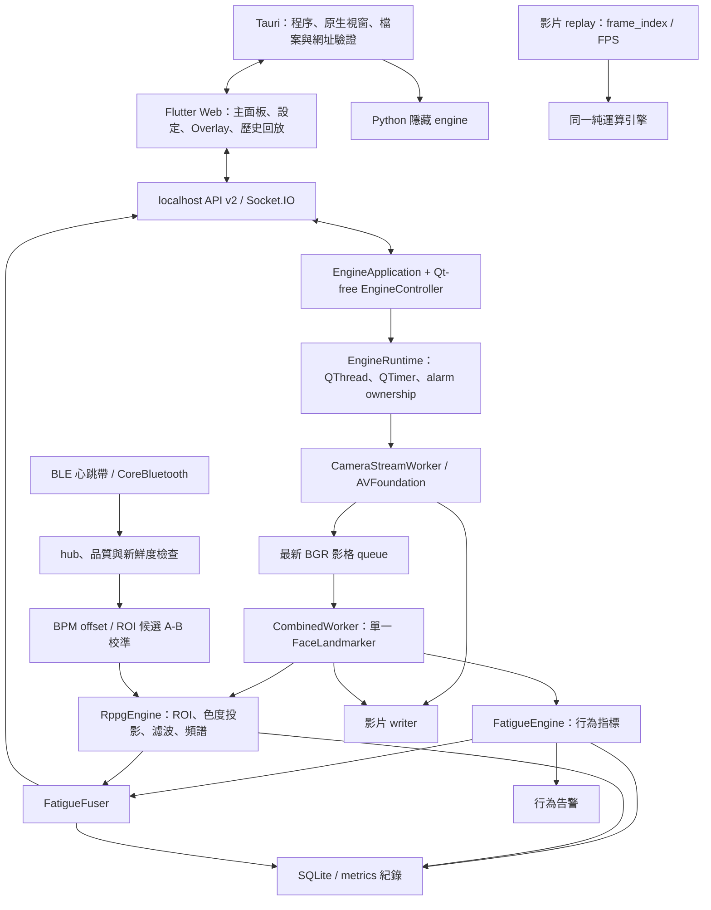

# REA 與原始碼全模組審核：macOS 優先

日期：2026-10-22。原始碼基準：`3ef4f23`；修正分支：`codex/macos-rea-audit`。

## 1. 審核範圍與證據等級

本報告涵蓋正式 Python engine、Tauri shell、Flutter Web、相機、三種分析 worker、疲勞、rPPG、HRV、個人基線、BLE、校準、告警、錄影、SQLite、Web、File Browser、影片回測、打包、診斷及行動平台邊界。逐檔符號、dataclass 欄位、設定、命令及路由見 [模組與契約清冊](macos_rea_module_inventory_2026-10-22.md)。清冊列出可回到原始碼的細節，不把靜態列舉當成逐分支覆蓋率。

REA 用於實際已安裝的 macOS 二進位及受控執行；完整原始碼則直接閱讀與測試，沒有為取得既有原始碼而反編譯。依據 [REA 官方專案](https://github.com/morluto/rea) 的目標分流，這兩種證據互補。

- **實測**：REA 的 Mach-O／簽章／plist 觀察、受控程序，以及本次實際執行的測試。
- **原始碼觀察**：能從函式、呼叫端及設定確定的資料流與條件。
- **推論／待驗證**：硬體精度、長時間穩定性、未執行平台與正式發佈；不宣稱已通過。

初始工作樹乾淨。未讀取 `.env` 值，未新增使用者可選環境參數，未提交模型、資料庫、錄影、個人校準或原始 REA 工作檔。指定的 Windows Claude rules 目錄與本機 `~/.claude/rules` 均不可取得，依 repository 的 `AGENTS.md`、`CLAUDE.md` 與已載入的 Ponytail／REA 規則執行。

## 2. 系統實際結構

圖中的 replay 是同一演算法的離線入口，並不共用即時 worker 的 thread 實例。只啟用行為或 rPPG 時分別使用 `FatigueWorker`／`RppgWorker`；兩者同時啟用必須使用 `CombinedWorker`，避免兩個 FaceLandmarker 搶影格。

### 啟動、控制與停止

1. macOS 啟動腳本檢查 source runtime，Tauri debug 使用 checkout engine；release 使用 `.app/Contents/Resources/engine` 的 PyInstaller sidecar。
2. Python 在建立 QApplication 前處理平台初始化，production adapter 為 QObject，不建立可見 Qt 主面板。
3. macOS backend 為 `127.0.0.1:5055`；Flutter 開發 port 為 1420。前者避開 AirPlay Receiver 常用的 5000，兩端設定必須一致。
4. Flutter 以 HTTP 控制狀態／命令，以 Socket.IO 接 metrics／JPEG；連線失敗時以 HTTP snapshot 輪詢。恢復串流後取消 fallback。
5. 控制命令經 `DesktopCommandBroker` 送回 Qt owner thread。設定先改 runtime，只有 `settings.save` 原子持久化。
6. Replay 以 cooperative stop、finished callback 與 shutdown defer 收尾；camera／analysis／video 的 timeout 仍保留 ownership。Tauri 最後才作 child-process kill fallback。
7. 本次改為由 `WebServerThread` 持有 Werkzeug server，以 event 停止 accept／dispatch，關閉現存 Engine.IO transport，避免 LAN restart 遺留舊服務。

Python 不直接開啟瀏覽器、資料夾或原生 shell UI；只回傳 `shell_action`，由 Flutter 交給驗證過的 Tauri 命令。

## 3. 逐模組技術研究、審核與決策

「保留」表示讀取了該責任與相鄰契約，目前沒有足夠證據支持改寫；不表示沒有剩餘缺陷。每個檔案的入口與資料結構另列於清冊。

| 模組／檔案 | 輸入、輸出與關鍵細節 | 技術對照 | 本次決策 |
| --- | --- | --- | --- |
| `main.py` | Tauri／engine／隔離 preflight 分流，Qt plugin 初始化順序 | MediaPipe、PySide6、PyInstaller | 保留啟動順序；source 與 packaged 模型初始化皆實測 |
| `gui/platforms/*` | Windows DSHOW/MSMF、macOS AVFoundation/CPU、Linux V4L2；mobile fail-closed | OpenCV registry、MediaPipe delegate | 保留平台隔離與版本鎖定 |
| `camera_devices.py` | 掃描、後端選擇、首幀檢查、解析度／FPS negotiation | [OpenCV 相機後端](https://github.com/opencv/opencv/blob/4.x/modules/videoio/src/cap_avfoundation_mac.mm) | 保留 AVFoundation 優先；無實機可測，未調 FPS／曝光 |
| `camera_stream_worker.py`、`frame_queue.py` | perf_counter timestamp、latest-frame queue、30 FPS 預覽上限、60 幀 FPS 視窗、黑幀診斷 | Qt signal／OpenCV capture | 保留即時採樣與丟棄舊幀策略 |
| `engine_controller.py`、`desktop_control.py`、`desktop_settings_contract.py` | Qt-free 狀態／strict JSON validation／命令回應 | Tauri process boundary、Python queue | 保留 API v2 與 runtime-first 設定契約 |
| `engine_runtime.py`、`worker_safety.py` | thread ownership、stale-finish、join-before-release、fail-closed | [Qt QThread](https://doc.qt.io/qt-6/qthread.html) | 保留；timeout 不提前釋放 worker |
| `main_window.py` | engine adapter、routing、metrics、錄製、校準與 shutdown | 現有 runtime owner | 修 BLE 重新啟用檢查、錄製命名及影片收尾狀態 |
| `combined_worker.py`、`fatigue_worker.py`、`rppg_worker.py` | 單一臉部推論、profile pending update、preview／metrics 分流 | [MediaPipe FaceLandmarker](https://github.com/google-ai-edge/mediapipe/blob/master/mediapipe/tasks/python/vision/face_landmarker.py) | 保留 worker topology、timestamp、數值路徑 |
| `fatigue_engine.py` | EAR／眨眼、PERCLOS、下視 gate、頭姿、凝視、虹膜、瞇眼、皺眉、哈欠 | OpenCV solvePnP、MediaPipe landmarks；[OpenFace](https://github.com/TadasBaltrusaitis/OpenFace) 作替代技術比較 | 保留已校準規則，不替換模型／門檻 |
| `fatigue_scorer.py` | 15% rPPG＋85% 行為、品質 gating、閉眼強通道、等級 hysteresis | 本地 golden／regression | 保留公式；UI 危急行為狀態不得被較低融合分數覆蓋 |
| `personal_profile.py` | 清醒基線 collector、manual 優先、相對門檻與 clamp | 個體基線設計、既有 profile 測試 | 保留 `profile=None` 數值契約 |
| `mediapipe_tuning.py`、`config/mediapipe_tuning.json` | profile merge、ROI smoothing／quality／blendshape calibration | MediaPipe options | 保留 stable_indoor；profile 需重啟 worker |
| `model_assets.py`、`runtime_paths.py` | 固定 URL＋SHA-256、temp/fsync/replace；唯讀資源與可寫資料分離 | Python pathlib／atomic replace | 保留；避免 `.app` 內寫入與路徑逃逸 |
| `rppg/rppg_worker.py` | 四 ROI、RGB 時序、CHROM 類投影、SOS 濾波、Welch／插值、BPM guard | rPPG-Toolbox、pyVHR、SciPy | 更正算法歸屬文字，保留公式與 ROI 混合 |
| `rppg_hrv_engine.py` | 自適應 peak、IBI MAD 清理、RMSSD／SDNN／LF-HF、confidence | [SciPy signal](https://docs.scipy.org/doc/scipy/reference/signal.html) | 保留，短窗 LF/HF 限制另述 |
| `demo_rppg_live.py` | 獨立展示／相機診斷；helper 與正式 engine 並非全部相同 | OpenCV／SciPy | 更正 CHROM 類說明；不當成正式 parity 基準 |
| `calibration_watch.py`、`watch_physio.py` | thread-safe belt hub、RR 優先，缺 RR 時以 BPM 反推 | BLE Heart Rate Service、既有測試 | 保留；Watch 命名是歷史資料結構，不是額外手錶模式 |
| `hr_belt_ble.py`、`belt_runtime.py` | 0x180D／0x2A37、uint8/16、contact、RR 1/1024 秒、async reconnect | [Bleak](https://github.com/hbldh/bleak) | 修 stop timeout ownership 與 restart；有效樣本解析不變 |
| `calibration.py` | scale/offset、版本 manifest、active、live feed | Python UUID、tempfile、os.replace | 修同秒覆寫、原子寫入、失敗 cache 一致性與刪除順序 |
| `adaptive_calibration.py` | median residual、低增益 EMA、品質 gate、限幅、候選採用／回退／冷卻 | pyVHR／rPPG-Toolbox 作研究對照 | 保留護欄與預設 OFF；未啟用新的自適應功能 |
| `belt_truth_capture.py`、`rppg_param_replay.py` | JSONL 同步 ROI／真值、共同 timestamp 交集的公平 A-B | Python JSON 有限值規則 | 修壞型別與非有限值；有效資料輸出不變 |
| `alarm_config.py`、`alarm_player.py` | strict config、持續時間／優先級／重複間隔、Qt 音訊 | [Qt Multimedia](https://doc.qt.io/qt-6/qtmultimedia-index.html) | 保留警報條件及 fallback；UI 對齊危急狀態 |
| `global_hotkeys.py` | application-level native hotkey，實作目前 Windows-only | OS 能力契約 | 移除 Flutter macOS/Linux 不實 capability，依 runtime 禁用設定 |
| `overlay_runtime_state.py`、`desktop_models.py` | physical-pixel geometry、負座標、多螢幕、opacity／locked | Tauri window API | 保留單一狀態來源，補 UI refresh 不重入 |
| `capture_preferences_state.py`、`replay_runtime_state.py`、`web_preferences_state.py` | toggle 持久化；replay／自動採集部分 session-only | 現有 settings schema | 保留 schema，未增加 `.env` 選項 |
| `metrics_recorder.py` | 非阻塞 queue、WAL、100 筆／1 秒 flush、meta sidecar | [SQLite transaction／backup](https://docs.python.org/3/library/sqlite3.html) | 修失敗批次 rollback，DB／stats／meta 一致 |
| `video_recorder.py` | ffmpeg/libx264→mpeg4→OpenCV；RGB888／BGR writer | [Qt QImage](https://doc.qt.io/qt-6/qimage.html)、ffmpeg | 修 row padding，保留來源與 encoder policy |
| `video_replay.py`、replay／golden／accuracy scripts | deterministic timestamp、單／多進程、DB／CSV／HTML、UTA 標籤 preset | UTA-RLDD 官方資料、既有 golden | 保留回測流程；本機無資料集，未跑 golden 真影片 |
| `web_server.py` | localhost control、LAN token、HTTP／Socket.IO、錄製列表／分頁／串流 | Werkzeug、Flask-SocketIO、Engine.IO | 修停服／遲到請求／transport 清理、Host/Origin、WAL snapshot／上傳 gate |
| `file_browser_client.py` | session/token、串流下載／上傳、progress、401 refresh | [Requests](https://github.com/psf/requests)、[File Browser](https://github.com/filebrowser/filebrowser) | 修重試空 body 與換站舊憑證；不新增外部上傳 |
| Flutter `backend_service.dart`／contracts | lossless JSON model、HTTP errors、socket／fallback | [socket.io-client-dart](https://github.com/rikulo/socket.io-client-dart)、Dart Timer | 修 timer ownership、單次在途請求、12 秒等待上限 |
| Flutter `main.dart` | 主面板、Overlay、警報／設定、歷史回放 | Flutter responsive widgets | 修融合與危急色、分頁／相對秒數、重複輪詢、失效快捷鍵 |
| Flutter Tauri bridge／stub | invoke、原生 geometry、shell intent、folder picker | [Tauri 安全與程序模型](https://github.com/tauri-apps/tauri-docs/blob/v2/src/content/docs/concept/process-model.md) | 保留 web/native 邊界與失敗回應 |
| `src-tauri/*` | Rust 程序群組、readiness、單次 shutdown、window／URL/path 驗證 | Tauri／serde／WKWebView | 保留；REA 核對已安裝 Mach-O 與權限 |
| macOS build／sidecar／preflight scripts | 本平台建置、模型資產、source/package smoke | [PyInstaller](https://github.com/pyinstaller/pyinstaller) | 修 preflight 真正後端查詢；明列 Socket.IO／Engine.IO 下限 |
| benchmark／hardware／installed smoke scripts | readiness、command latency、preview encode、硬體生命週期 | Apple ps、既有診斷工具 | 補 macOS 程序樹 RSS；保留測量邊界 |
| Android／iOS runner 與 native stubs | method/event channel、permissions／inference planned | Flutter platform channel | 保留 fail-closed，未宣稱行動版已完成 |
| PDF／poster／Canva 工具、typings、CI | 報告產出與開發輔助，不是 live pipeline | reportlab／現有工具鏈 | 清冊列舉，未新增依賴或重寫設計工具；CI 仍僅 hygiene |

## 4. 數值路徑的準確說明

### rPPG

有效皮膚 ROI 為 forehead、L_cheek、R_cheek、glabella。預設 base weights 為 0.34／0.25／0.25／0.16，但預設混合是有效 ROI 等權平均；base weights 也參與姿態、遮擋與可用性判斷。只有有效校準 override 路徑啟用 weighted mix，不能把預設 BPM 描述成直接按這四個比例加權。

`pos_pulse` 的實際公式是：各色頻 `c'=(c-mean(c))/(std(c)+1e-8)`；`X=3R'-2G'`、`Y=1.5R'+G'-1.5B'`；`pulse=X-std(X)/(std(Y)+1e-8)*Y`。這是 **z-score＋CHROM 類投影**，與原版 CHROM 也不完全相同。[標準 POS](https://github.com/ubicomplab/rPPG-Toolbox/blob/main/unsupervised_methods/methods/POS_WANG.py) 的 mean normalization、投影矩陣與 overlap-add 不能混為本專案現況；[pyVHR](https://github.com/phuselab/pyVHR/blob/master/pyVHR/BVP/methods.py) 亦可交叉對照。

正式 engine 保留 SOS Butterworth＋sosfiltfilt、Welch peak 與 log-power 峰值插值。SOS 是 [SciPy 建議形式](https://docs.scipy.org/doc/scipy/reference/generated/scipy.signal.butter.html)，沒有理由為平台調整換回不穩定的高階多項式濾波。BPM 約每 5 秒重算、10 秒歷史 median＋EMA；42–210 BPM 合理範圍與跳變確認保持不變。HRV 另需足夠的 30 秒訊號，不能只看 12 秒 BPM buffer 就宣稱 HRV 已成熟。

### 行為與融合

EAR 是兩組垂直眼距之和除以兩倍水平眼距；啟動約 5 秒收集開眼基線，再配合閉眼 hysteresis、品質／頭姿／下視 gate。下視 detector 與真閉眼解除條件保留，避免把看下方螢幕誤算閉眼。PERCLOS 是時間窗比例，不是分類準確率；API 即時 `perclos` 為百分比，DB 欄位仍為比例，兩者顯示不可共用同一倍數。

融合預設為行為 0.85、rPPG 0.15，品質不足時重分配有效權重。持續閉眼通道從 1 秒後線性加強，8 秒飽和，另有等級下降 hysteresis。`fusion_confidence` API 的值實際來自 `FusedFatigueScore.score`，是疲勞分數，**不是校準過的分類信心機率**。

行為 `CRITICAL`／`MICROSLEEP` 與融合等級不同步是可發生的：例如閉眼 1.5 秒可觸發立即危急狀態，但融合仍低。UI 現在保留立即危急警訊的優先權，避免顯示清醒而聲音告警；一般情境呈現融合等級。

### BLE、校準與 HRV

BLE 是背景真值來源，不直接加入疲勞融合權重。RR 封包以 1/1024 秒解析；有實測 RR 時優先使用，缺 RR 才用 `60000/BPM` 反推，不能把後者視為逐搏量測。校準以未套校正的 BPM 路徑比較真值；`calibration_rppg_bpm` 在 guarded 時取 raw、一般情況可取平滑 bpm，並非所有入口永遠直接取 `raw_bpm`。

30 秒 rPPG HRV 視窗無法支持長週期生理推論；目前 LF/HF 的 4 Hz、最多 64 點 PSD 格距至少 0.0625 Hz。`HIGH` 是內部 SQI／artifact／IBI 品質等級，不能解讀成醫療有效性。這次沒有調整上述公式、視窗或閾值。

## 5. 已修正問題與驗證重點

| 問題 | 修正後行為 | 主要回歸驗證 |
| --- | --- | --- |
| Werkzeug 舊 shutdown hook 消失，停服回 503 | owner event＋server handle loop；移除失效 HTTP endpoint/token | 真 WebSocket、未接續 GET 的 polling、停服後 port 可重用 |
| 停服時先接受但未完成 header 的請求可再建 session | 在 Socket.IO middleware 外層拒絕停止後的新 dispatch | partial-header 補完後為 503，沒有新 Engine.IO session |
| Web client 計數跨 app 共用 | 每個 app 擁有自己的 client set | 既有 socket client／frame tests |
| BLE timeout 提前丟失 thread/client，重啟復活舊通知 | 保留 ownership，stopping 時拒絕 restart，adapter 不建立新校準器 | 低層 timeout／notification＋production adapter regression |
| 校準同秒 ID 覆寫前版 | UUID 版本識別，舊 ID 仍照常讀取 | 固定時鐘同秒連存兩版，可分別讀回 |
| 校準 JSON 中斷破檔，失敗時 cache 假裝已儲存 | temp/fsync/replace，成功才發布 manifest cache；先寫 manifest 再移除舊版檔 | helper replace failure＋save/activate/delete store failure |
| SQLite 批次中途失敗的前段資料被下次 commit | connection transaction context 自動 rollback 整批 | DB／record count／meta 僅含後續成功批次 |
| File Browser 401 重送耗盡 iterator | 每次 request 建立新 upload iterator | 兩次 body 完整且相同，progress 重算 |
| 改站登入失敗保留舊 token | 重設前停止 heartbeat、清認證與 cookies | 新站登入失敗後未認證、無舊 token |
| 上傳裸 WAL DB 缺 schema／已提交資料 | SQLite backup 至暫存一致快照，再以上傳原名傳送 | 保持原 DB 的 WAL 開啟，快照可讀出資料，之後清理 |
| 上傳仍在寫入的影片 | recording 或 video finalizing 時回 409 | active／finalizing gate |
| 敏感本機 API 只驗 peer IP | control/fb 同時驗 Host／Origin，保留 Tauri 與 IPv6／無 Origin 原生請求 | evil Host／Origin 拒絕、合法桌面 origin 通過 |
| 同秒錄製重用 DB／覆蓋影片 | 錄製名稱加入微秒，DB／影片共用同一 stamp | 既有錄製／回放命名與列表測試 |
| QImage padding 被當成 RGB 像素 | 先按 bytesPerLine 分列、裁有效像素，再轉 BGR contiguous | 641×2 RGB888 含 padding 的真 QImage |
| preflight 只看到 CAP 常數就判定可用 | 查 `getCameraBackends()`＋`hasBackend()` | 無 registry／註冊但未載入／可用後端三種情況 |
| UI 隱藏融合／危險狀態使用一般色 | 明確代碼對照、融合呈現、立即危急優先 | 行為／融合矛盾 payload、focus dashboard |
| fallback 重連後不停止／慢請求重疊 | timer cancel/reset、輪詢 single-flight、12 秒等待上限 | 延遲 HTTP、連線恢復、再次斷線、取消訂閱 |
| 歷史回放只取前 200 筆，epoch 被印成秒數 | bounded page＋offset/total、跨頁保留起始時間、忽略過期回應 | offset query、下一／上一頁、epoch 相對秒數 |
| macOS/Linux 宣稱可用全域快捷鍵 | 移除不實 capability，設定依 runtime supported 禁用 | Windows 保留、macOS/Linux capability、disabled widget |
| macOS benchmark RSS 為 null | ps 取 RSS KiB 轉 bytes，包含程序樹 | 假 ps 三層程序資料與單位換算 |

這些是已重現且有對應修正的問題組，不是效能改善百分比，也不代表所有分支已無缺陷。

## 6. REA 實際證據

目標為本機 `/Applications/疲勞監測操作台.app`，未覆寫已安裝程式。檢查的 shell SHA-256 為 `47ce8f8847274b4a8476f70c7da51263e30577f736588d73097b449821b89b5a`。

| 觀察 | Evidence ID | 結果／界限 |
| --- | --- | --- |
| source runtime preflight | `ev_100f69ee18dd0c823c07744650d733ad6954970f8a83fc8e537fce488797a3ec` | macOS 通過，含隔離 FaceLandmarker 初始化；不是相機精度測試 |
| Mach-O metadata | `ev_ff90a3d8c9b128df2ce714bcaab8f7ca4d13ff02c3f9540939b6c1d77fa30e61` | arm64、64-bit；1 個 entrypoint、30 個 load commands、13 個 dylib dependencies |
| Mach-O build metadata | `ev_7498e2119f11fcd72e21e646e301571870e8e797b6ccecd366c2dfbad3863c74` | MACOS minimum 15.0、SDK 26.5 |
| dylib dependencies | `ev_fb8c9efc6346bbbf7015af65b56bd39a4eb42d71905b7e0468d3450ab18287d9` | 含 AppKit、WebKit、CoreVideo、Foundation；不代表每個 runtime path 都曾執行 |
| 簽章 | `ev_f3a11682422e36fa401f29f2dd17b77f07e08d363830def76977949b3312dd70` | signed、hardened runtime、camera/bluetooth entitlements；無 Team ID／authority，符合本機 ad-hoc 配置，不能宣稱公證通過 |
| Info.plist | `ev_701675e8531a83c164ce99ffd6e0a90f3129bd49f82080078d48d0ee1e3f3b41` | identifier `tw.fatigue-monitor.desktop`、版本 0.1.0、相機及 Bluetooth usage description |
| 已安裝 engine 模型初始化 | `ev_cf30f077e31b11fcf0eed279993307938a6fdca5411a113f977d27690376c002` | exit 0；XNNPACK CPU delegate；GL context 曾初始化並不等同推論使用 GPU |

Mach-O imports／exports 受 stripped symbols 與原生工具限制，不宣稱完整；沒有反編譯每個原生依賴，也沒有以符號存在推論函式已執行。受控程序有取樣與 inherited environment 限制，未監聽網路或記錄 filesystem syscall。

REA 原始證據已匯出至本機 `output/rea-macos-2026-10-22.json`，含 16 筆 records 與 8 筆工具列出的 unknowns；檔案屬忽略的工作產物，不隨原始碼提交。REA target 已關閉。

## 7. 版本與驗證紀錄

實測環境為 macOS arm64、Python 3.12.14；本機套件包含 MediaPipe 0.10.35、OpenCV contrib 5.0.0.93、NumPy 2.5.2、SciPy 1.18.1、PySide6 6.11.2、Bleak 3.0.2、Flask 3.1.3、Werkzeug 3.1.8、Flask-SocketIO 5.6.1、python-socketio 5.16.4、Engine.IO 4.14.0、simple-websocket 1.1.0。

Web 依賴下限收斂到已驗證組合：`Flask-SocketIO>=5.6.1`、`python-socketio>=5.16.4`、`python-engineio>=4.14.0`。原先允許的 Flask-SocketIO 5.3.0 在本機 Flask 3.1.3 實測觸發 RequestContext session setter 錯誤；中間組合 Socket.IO 5.12.0／Engine.IO 4.11.0 的 HTTP 測試可通過，但 WebSocket integration 未收到 open packet，因此不宣稱支援。改用目前組合後，在隔離 import 目錄重新驗證 49 項 Web／control 測試皆通過，沒有在正式 `.venv` 降級／升級數值套件。

上游早期 tag 已有 [Socket.IO shutdown](https://github.com/miguelgrinberg/python-socketio/blob/v5.11.0/src/socketio/server.py) 與 [Engine.IO 非阻塞 close](https://github.com/miguelgrinberg/python-engineio/blob/v4.9.0/src/engineio/socket.py)，但單看 API 存在不足以保證整合相容。本次直接驗證可工作版本，沒有加入舊版兼容 wrapper。這不是所有 Flask、Werkzeug、Socket.IO 歷史版本的完整矩陣驗收。

最終執行結果記於本節完成版；所有命令由 repository root 執行，Flutter 命令於 `flutter_app/`。

| 驗證 | 結果 |
| --- | --- |
| 變更前完整 `python -m pytest -q` | 823 passed，2 skipped |
| 變更前 Flutter test／analyze | 43 passed；No issues found |
| 最終完整 `.venv/bin/python -m pytest -q` | 858 passed，2 skipped；跳過為平台限定路徑測試 |
| `.venv/bin/python -m compileall -q main.py gui rppg scripts tests` | 通過 |
| `.venv/bin/python -m pip check` | No broken requirements found |
| `.venv/bin/python -m scripts.runtime_preflight` | macOS 通過，含隔離模型初始化 |
| `flutter test --reporter expanded` | 49 passed |
| `flutter analyze` | No issues found |
| `flutter build web --release --no-web-resources-cdn --dart-define=NCFD_BACKEND_URL=http://127.0.0.1:5055` | 成功；有非阻斷的 Wasm／字型工具訊息 |
| `cargo test --manifest-path src-tauri/Cargo.toml --locked` | 13 passed；先重建本機舊 sidecar 以修復缺失 framework 資源 |
| `.venv/bin/python -m scripts.build_engine_sidecar` | 成功；新 sidecar 的 runtime 與 FaceLandmarker preflight 通過 |
| 隔離 Web 依賴下限目錄的 Web／control pytest | 49 passed；其餘依賴沿用本機版本 |
| `git diff --check`、repository hygiene、JSON/plist 與文件連結檢查 | 通過 |
| source 相機 raw smoke | 失敗：API 沒有列出可用相機；未偽造通過 |
| UTA-RLDD golden check | 本機未找到資料集，未執行；未更新 baseline |
| 三重審查 | 官方／版本、程式與部署、慣例與 UI 三軸，另完成修改後覆核 |

數值行為影響聲明：有效相機／ROI／rPPG／疲勞／HRV／校準樣本的計算公式、門檻、模型版本、融合權重皆未修改。capture loader 現在拒絕壞結構及非有限值；失敗 SQLite 批次不再殘留部分資料；版本／錄製識別與 UI 呈現會改變。測試通過不代替真影片 golden 或硬體精度驗證。

## 8. macOS 量測與後續驗收

本次執行 `desktop_engine_benchmark --samples 30 --warmup 5`：readiness、command latency、合成 JPEG 編碼及 RSS 見 [量測記錄](../benchmarks/macos-rea-audit-2026-10-22.json)。這是變更後的單機觀察；沒有建立可比的變更前／後實機相機對照，所以不宣稱 CPU／FPS 提升百分比。合成 preview 排除相機、網路、WKWebView 解碼與 Flutter rendering；程序樹 RSS 加總也不是獨占實體記憶體或 peak memory。

此次單次量測為 API ready 約 2.047 秒、state command p95 約 21.066 ms、合成 640×360 JPEG 編碼 p95 約 0.913 ms、ready 時程序樹 RSS 約 326.953 MiB。合成 server dispatch 次數／秒不是攝影機 FPS。

仍需以下實際條件才能完成產品驗收：

1. 接上可見的實體相機，分別執行 raw／fatigue／rPPG／combined，量測 30 分鐘以上 FPS、queue 延遲、CPU/RSS、遮擋／黑畫面與反覆啟停。
2. 使用真心跳帶驗證首次權限、scan/connect cancellation、斷線重連、stop timeout 與裝置移除；再用同步 capture 比對 raw／校正 BPM 誤差。
3. 取得 golden 的 UTA-RLDD subject 04 三類固定影片後執行 check；跨 MediaPipe／OpenCV 平台的差異應調查，不能直接重建基準掩蓋。
4. 在 WKWebView 實際驗收 Overlay click-through、負座標多螢幕、focus／resize、休眠喚醒、LAN 切換與關閉視窗；Flutter widget 測試不代替原生驗收。
5. 重新建置 `.app/.dmg` 才會帶入本次修正；本次檢查的既有安裝包仍是舊二進位。公開發佈另需 Developer ID signing／notarization。

未落地的選項：標準 POS／深度 rPPG 模型替換、Metal 推論、加大採樣率、ROI／疲勞門檻重調、移除 Qt runtime、行動版推論、完整 CI matrix。它們各自需要資料／硬體或交付驗收，不能當作本次已完成的優化；目前 CI 仍僅檢查 repository hygiene。
